<div align="center">



<sub>↑ o dispositivo <b>Gabriel Fernandes</b> acabou de passar na verificação de conformidade. Se perdeu a animação, recarregue a página.</sub>

</div>

<br>

De dia eu cuido de **computadores corporativos** que precisam estar seguros, atualizados e em conformidade: Windows e macOS, com Intune e Jamf.
De noite eu construo **coisas que não precisavam existir, mas agora existem**: uma mosca com cérebro de verdade, um app que diz o nome das montanhas, um toca-discos 3D.

<br>

## 🧭 Escolha seu caminho

<details>
<summary><b>💼 Sou recrutador(a)</b> · <i>o resumo em 20 segundos</i></summary>

<br>

| | |
|:--|:--|
| **Cargo atual** | Analista de Suporte Pleno @ Stefanini Brasil |
| **Especialidade** | Modern Workplace e Endpoint Management (Microsoft Intune, Jamf Pro, Autopilot, MDM) |
| **Também faço** | Aplicações web completas: front, banco, deploy e automações |
| **Formação** | Análise e Desenvolvimento de Sistemas · Estácio |
| **Onde** | Rio de Janeiro, RJ · aberto a remoto ou híbrido |
| **Diferencial** | Eu crio as ferramentas que o suporte precisa: geradores de KB para o ServiceNow, processadores de CSV para o Autopilot, plataformas de treinamento |

**Próximo passo:** [me chama no LinkedIn](https://www.linkedin.com/in/gabrielfsc002/) 👋

</details>

<details>
<summary><b>👨‍💻 Sou dev</b> · <i>me mostra a stack</i></summary>

<br>

<p align="center">
  
  <br>
  
</p>

<p align="center">
  
  
  
  
  
</p>

**Como eu costumo trabalhar:** protótipo rápido (Lovable ou Claude Code) → TypeScript com Supabase → deploy na Vercel ou na Cloudflare → itera com quem usa de verdade.

</details>

<details>
<summary><b>🪰 Só tô curioso(a)</b> · <i>me conta algo estranho</i></summary>

<br>

Em um dos meus projetos, a mosca que você tenta acertar **não tem nenhuma regra de fuga programada**. Ninguém escreveu `if perto: fugir`.

Ela é pilotada por um pedaço do **cérebro real de uma _Drosophila_**: 21.739 neurônios e 3,5 milhões de sinapses do conectoma _hemibrain_, simulados mil vezes por segundo.

Quando ela foge do mata-moscas, é a fiação de uma mosca de verdade decidindo. 🧠

</details>

<br>

## 🧪 Laboratório

<div align="center">
  
  <br>
  <sub>Os repositórios são privados. Quer ver algum funcionando? <a href="https://www.linkedin.com/in/gabrielfsc002/">Me chama</a> que eu mostro.</sub>
</div>

<br>

## 🎲 Verdade ou mentira?

<sub>Chute antes de abrir.</sub>

<details>
<summary><b>1.</b> Eu fiz o site da lista de presentes do meu próprio casamento.</summary>
<br>

✅ **Verdade.** Catálogo, carrinho, Pix dinâmico e painel de administração. Cada presente sai da lista quando alguém dá. O noivo também era o dev.
</details>

<details>
<summary><b>2.</b> Tenho um app que identifica as montanhas que você está vendo.</summary>
<br>

✅ **Verdade** (em construção). O PeakLens cruza a câmera e o GPS do celular com o relevo do satélite Copernicus e os picos do OpenStreetMap. Escrito em Rust e Kotlin, começando pelo Rio de Janeiro.
</details>

<details>
<summary><b>3.</b> Nunca deixei um projeto pela metade.</summary>
<br>

❌ **Mentira.** Tenho uma pasta inteira de repositórios arquivados para provar. Mas cada um me ensinou algo que foi parar no próximo.
</details>

<details>
<summary><b>4.</b> Um dos meus jogos usa dados de verdade de neurociência.</summary>
<br>

✅ **Verdade.** Abre o "🪰 Só tô curioso(a)" lá em cima.
</details>

<details>
<summary><b>5.</b> Escrevo todo o código sozinho, sem ajuda nenhuma.</summary>
<br>

❌ **Mentira.** Trabalho junto com IA (Claude Code, Lovable) e não escondo isso. Eu decido o que construir e por quê, reviso tudo e garanto que funciona. A IA digita rápido.
</details>

<br>

## 📡 Agora

```diff
+ construindo   PeakLens: reconhecimento de montanhas no celular
+ estudando     Análise e Desenvolvimento de Sistemas · Estácio
+ melhorando    Ferramentas internas para o time de suporte
- dormindo      o suficiente
```

<br>

<div align="center">

<picture>
  <source media="(prefers-color-scheme: dark)" srcset="https://raw.githubusercontent.com/gabrielfernandessc/gabrielfernandessc/output/github-snake-dark.svg" />
  <source media="(prefers-color-scheme: light)" srcset="https://raw.githubusercontent.com/gabrielfernandessc/gabrielfernandessc/output/github-snake.svg" />
  
</picture>

<br><br>

[](https://www.linkedin.com/in/gabrielfsc002/)
[](https://www.instagram.com/_gfchagas/)


<sub>Este README passou na verificação de conformidade. ✓</sub>

</div>
